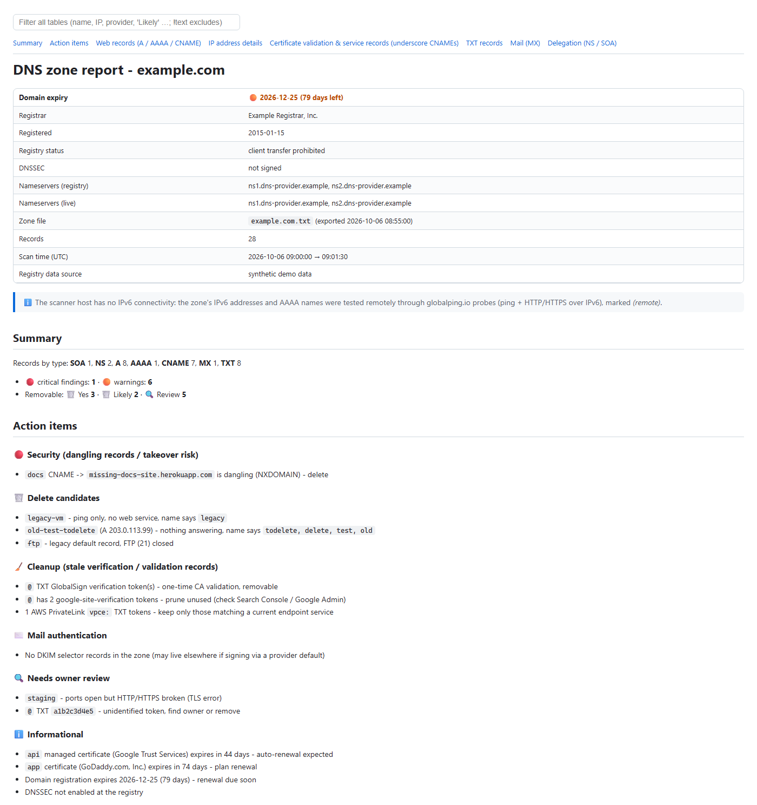
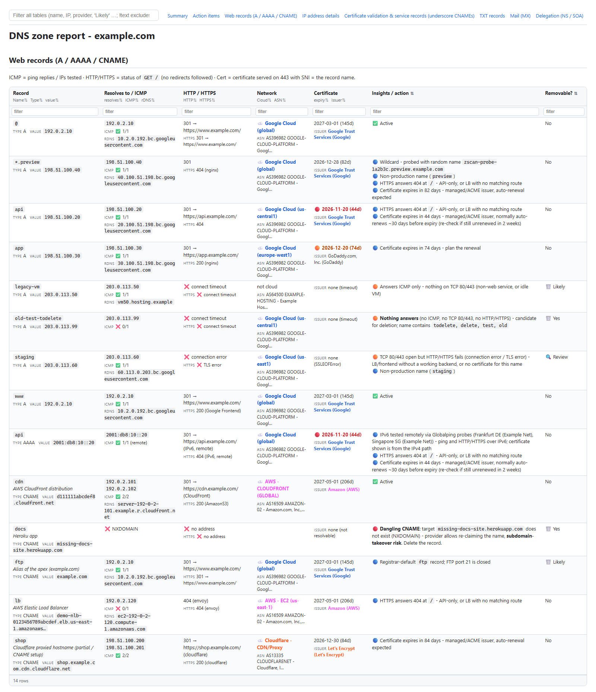
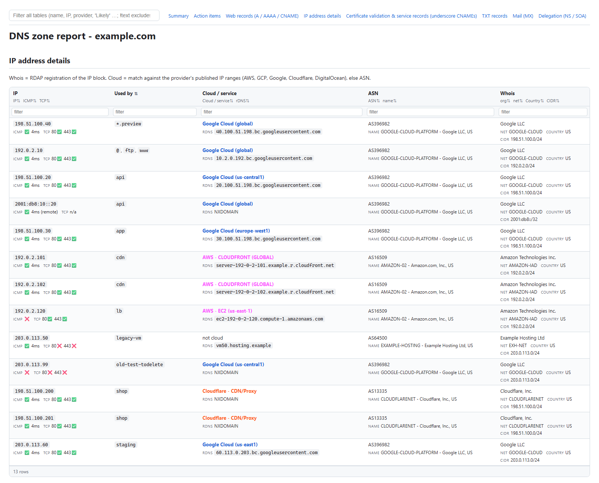
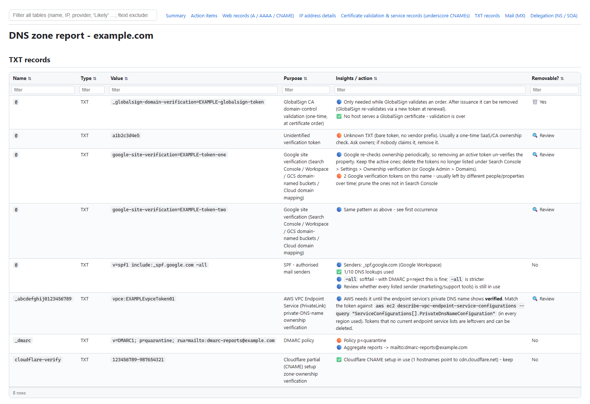

# dns-zone-scan

Scans exported DNS zone files (BIND format, e.g. GoDaddy "Export zone file") and produces a Markdown and an HTML report per zone. The report covers every record: what it points to, whether anything answers, who owns the IP, which certificate is served, and an **insight / removable?** verdict.

## What it checks

| Area | Details |
|---|---|
| Domain | Registry expiry date (RDAP, WHOIS fallback), registrar, status, DNSSEC, delegated vs. zone NS. The expiry date goes at the top of the report and is **red** when < 60 days away or already passed |
| A / AAAA / CNAME | Live resolution and CNAME chain, ICMP ping, TCP 80/443, HTTP and HTTPS `GET /` (status, server, redirect), dangling-CNAME / subdomain-takeover detection, wildcard probing via a random label |
| IP ownership | ASN, RDAP whois (org, net name, CIDR, country), reverse DNS, cloud provider + service/region from the official published ranges (AWS, GCP, Google, Cloudflare, DigitalOcean), with ASN as the fallback |
| Certificates | Issuer, issuer → provider (Google-managed, AWS ACM, Let's Encrypt, Cloudflare, GoDaddy…), expiry (**red** when < 60 days), name match, trust |
| Validation records | ACM `acm-validations.aws`, Google Certificate Manager `_acme-challenge`, `_globalsign-domain-verification`, `google-site-verification`, AWS PrivateLink `vpce:`, `cloudflare-verify`, Domain Connect, unknown tokens. Each one is cross-checked against the certificates actually served, to say whether it is still needed |
| Mail | MX provider and resolution, SPF include expansion + 10-lookup limit + broken includes, DMARC policy, DKIM key size |
| Drift | Each exported record is compared with what the authoritative nameserver serves now (SOA serial, changed/removed values) |

Every record gets a **Removable?** verdict: `Yes` (evidence says safe) · `Likely` (confirm with the owner) · `Review` (check in the provider console) · `No`.

## Screenshots

> All screenshots show a **synthetic demo zone**: the reserved `example.com` domain, documentation-only IP ranges (RFC 5737 / RFC 3849) and made-up tokens. No real scan data is used. Regenerate them with `python scripts/make_demo.py --screenshots`; the demo report itself is in [docs/demo/](docs/demo/).

**Header, summary and action items.** The domain expiry date sits at the top: orange when < 90 days away, red when < 60 days or already passed.



**Web records.** Liveness, cloud provider (GCP / AWS / Cloudflare in brand colours), certificate, insight and removability for every A / AAAA / CNAME. In the HTML report related fields are stacked in one cell (e.g. *Certificate* = expiry + issuer), so the table fits a normal screen without horizontal scrolling. Click a header, or a small field label under it (`expiry ⇅`, `issuer ⇅`, …), to sort by that field; type in the boxes under the headers to filter.



**IP address details.** One row per IP with ICMP/TCP, the records using it, cloud service/region, reverse DNS, ASN and whois (org, net, CIDR, country), ordered by the records that use each IP.



**TXT records.** Each verification token is explained, with whether it can be removed.



## Usage

```bash
pip install -e .            # or: pip install -r requirements.txt
                            # dev/tests: pip install -e ".[dev]"

# put zone exports in input/, then:
python -m dns_zone_scan                    # scan + report every file in input/
python -m dns_zone_scan scan  [files...]   # scan only  -> output/<file>.<YYYYMMDD_HHMM>.json
python -m dns_zone_scan report [json...]   # rebuild .md + .html from saved scans (default: latest per zone), no network
```

After `pip install`, `dns-zone-scan` works as a shortcut for `python -m dns_zone_scan` (same commands and options).

Options: `--input DIR`, `--output DIR`, `--workers N` (default 32), `--timeout SECONDS` (default 5), `--no-remote` (see IPv6 below), `--config FILE`, `--tcp-ports P1,P2` (overrides the config).

### Config

Optional settings live in `input/config.yaml` (git-ignored like the rest of `input/`, and never treated as a zone file):

```yaml
# Extra TCP ports probed on every IP, in addition to 80 and 443 (which are always probed)
tcp_ports:
  - 8080
```

Extra ports appear in the *TCP* column of the IP table, and an open extra port counts as "something answers" for the removal verdict.

Each zone file `input/<name>` produces:

- `output/<name>.<YYYYMMDD_HHMM>.json`: every raw fact collected, including full RDAP responses
- `output/<name>.<YYYYMMDD_HHMM>.md`: the report (Markdown)
- `output/<name>.<YYYYMMDD_HHMM>.html`: the same report as a self-contained web page. Wide tables are stacked to fit the screen; click any column header or field label to sort; per-column filter boxes (`text` contains, `!text` excludes), a global filter, section links, dark mode

The report is generated purely from the JSON. Improving the rules in `dns_zone_scan/insights.py` / `dns_zone_scan/knowledge.py` and running `python -m dns_zone_scan report` refreshes reports without re-scanning, and "days left" is always computed against the scan date.

`input/` and `output/` are git-ignored, so zone data and results never leave the machine.

## Notes

- The scan actively probes the hosts (ping, TCP connect, HTTP GET, TLS handshake). Run it only against zones you own.
- **IPv6 without local IPv6:** if the scanning machine has no IPv6, the zone's IPv6 addresses (ping) and AAAA names (HTTP/HTTPS over IPv6) are tested through the free [Globalping](https://globalping.io) probe network (no API key, 250 tests/hour; one scan uses ~2 tests per IPv6 address + 2 per AAAA name). Results are marked *(remote)*, and a name that works over IPv4 but not IPv6 is flagged as **IPv6 path broken**. This sends those public names/IPs to globalping.io; use `--no-remote` to disable it, and the IPv6 addresses are then marked *not testable* rather than *down*.
- AWS NLBs and some load balancers don't answer ICMP, so ICMP alone never triggers a delete recommendation.
- Cloud range lists and IP RDAP results are cached for 24h in `.cache/`.

## Layout

```
dns_zone_scan/
  parser.py     zone file -> records
  scan.py       orchestrates all live checks -> JSON
  resolve.py    DNS (CNAME chains, PTR, authoritative queries)
  probe.py      ICMP / TCP / HTTP
  certs.py      TLS certificate fetch + classification
  ipinfo.py     ASN + RDAP whois
  cloud.py      cloud provider IP-range matching
  domain.py     domain registration (RDAP / WHOIS)
  remote.py     IPv6 checks via Globalping probes when the machine lacks IPv6
  knowledge.py  record-pattern knowledge base
  insights.py   facts -> per-record insights / action items
  report.py     Markdown rendering
  html_report.py  HTML page (same content as the Markdown)
tests/          offline tests on synthetic data
scripts/make_demo.py  builds the synthetic demo report + README screenshots
```
